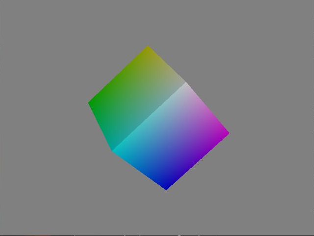
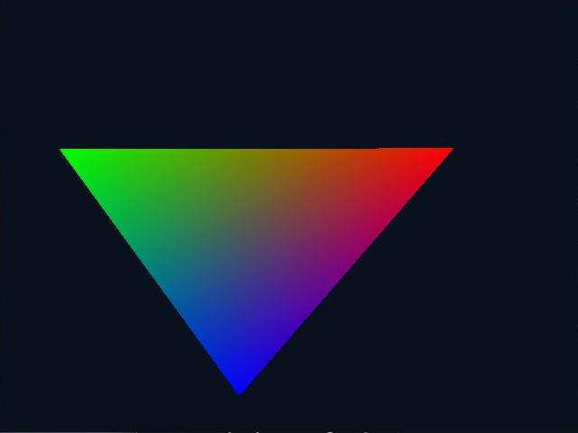

# Milestone 2: kmscube and SDL2 KMSDRM

Tested on 2026-10-19 using the existing ARM64 kernel and QEMU `gtk-gl` launcher.
Both applications rendered visible animations directly through DRM/KMS, GBM,
EGL and GLES, without an X11/Wayland server in the guest and without proprietary Mali
libraries. SDL2 source compilation was unnecessary: official Debian SDL2 2.32.4
already includes KMSDRM.

## Reproduce

Run host commands from the project directory **inside WSL Ubuntu**. Stop the
primary VM before copying its disk. The new copy is standalone; it has no
backing dependency on the working overlay or original raw image.

```bash
export WORK_DIR="$HOME/darkos-qemu-work"
bash scripts/graphics-copy.sh
DISK_IMAGE="$WORK_DIR/images/graphics.qcow2" bash scripts/run-qemu.sh gtk-gl
```

In another WSL shell, from the project directory:

```bash
export WORK_DIR="$HOME/darkos-qemu-work"
bash scripts/graphics.sh diagnose
bash scripts/graphics.sh prepare
bash scripts/graphics.sh kmscube
bash scripts/graphics.sh build
bash scripts/graphics.sh sdl
```

`graphics-copy.sh` refuses to overwrite an existing copy. QEMU's disk lock
prevents converting an active source. `BASE_DISK_IMAGE` overrides the copy source;
`DISK_IMAGE` overrides the graphics target and must also be supplied when using
the other helpers with a custom graphics disk. Mutating/test helper actions
verify the actual local QEMU process's disk and SSH forwarding before connecting.
They reject the primary and raw disks. Read-only `diagnose` can inspect either VM.

SSH uses the existing project identity. Optional `SSH_KEY`, `SSH_USER`,
`SSH_HOST`, and `SSH_PORT` select the connection; automatic disk verification
supports local WSL QEMU instances. A dedicated `graphics_known_hosts` file is used.
Custom `SSH_USER` is for diagnostics; deployment assumes the image's `ark` home.

Preparation refreshes Debian package indexes, records an install simulation and
package policies, and rejects proposed removals. It installs only the missing
test/build tools, then downloads official ARM64 SDL/EGL/GLES/GBM/Mesa runtime
and development packages into `/opt/darkos-graphics/packages/run.*`. Checksums
are saved; archives are extracted to `/opt/darkos-graphics` without replacing
system graphics libraries. There is no distribution upgrade.

The scripts must run against the graphics copy: preparation writes packages and
indexes inside that VM. The test used about 37 MB for seven newly installed
tool/dependency packages plus the separately extracted graphics prefix.

## Why a private graphics prefix is necessary

Package metadata alone was misleading. The image reported Debian Mesa and SDL2,
but `libgbm.so.1` and GLES symlinks pointed at `libMali.so`. Its SDL SONAME also
pointed to a modified SDL 2.32.10 binary instead of the packaged SDL 2.32.4.
The unchanged system `kmscube` failed with a Mali kernel-driver initialization
error; see [baseline](evidence/graphics/kmscube-system-baseline.log).

`graphics-env.sh` selects the private libraries and Mesa EGL vendor JSON,
including **both** `LIBGL_DRIVERS_PATH` and `GBM_BACKENDS_PATH`. Setting only
`LD_LIBRARY_PATH` is insufficient: GBM can otherwise load its system backend
and bring a second, older Gallium library into the process. No global loader
configuration or vendor symlinks are changed.

The demo links against the prefix's SDL/GLES development libraries. It requests
a GLES2 context, refuses any video backend other than KMSDRM, renders a rotating
colored triangle, and reports the runtime versions and presented frame count.
It exits normally after 30 seconds; `--drivers` lists compiled video backends.
The native ARM64 build command is in `demos/sdl-kms/Makefile`.

For manual guest execution after deployment:

```bash
sudo bash /home/ark/darkos-graphics/scripts/graphics-env.sh \
  /home/ark/darkos-graphics/demos/sdl-kms/hello --seconds 30
```

DRM nodes in this image are root-only; the initial tests intentionally use sudo.
Non-root seat/input integration remains a later task. Device selection discovers
the connected `virtio_gpu` card rather than assuming `card0`.

`kmscube` treats readable stdin, including SSH EOF, as a quit request. The runner
keeps a private FIFO open during its approximately 40-second test, then sends a
newline for normal DRM cleanup. SDL exits itself after its timed render loop.
Applications run sequentially so only one owns DRM master.

## Verified results

| Check | Result |
| --- | --- |
| Device | VirtIO `card0`, connected `Virtual-1`, 640×480 |
| kmscube | Official Debian `0.0.0~git20210103-1+b3`; visible rotating cube |
| kmscube timed run | 13,101 frames reported at 40.042 seconds; exit 0 |
| SDL runtime/backend | Official 2.32.4, `KMSDRM` |
| SDL timed run | 9,371 presented frames in 30.001 seconds; exit 0 |
| EGL vendor | Mesa Project, EGL 1.5 |
| GL vendor/version | Mesa; OpenGL ES 3.2 Mesa `25.0.7-2+deb13u1` |
| Renderer | `virgl (LLVMPIPE (LLVM 21.1.8, 256 bits))` |
| Live libraries | SDL/EGL/GLES/GBM/Gallium from the private prefix; no libMali |
| After tests | SSH and NetworkManager active; downloaded archive checksums pass |
| Shutdown/integrity | Guest poweroff, QEMU exit 0, qcow2 check passed, original raw checksum unchanged |

The renderer proves the VirtIO/VirGL route, with a software LLVMpipe renderer
on the host side. It does not establish native GPU acceleration or hardware-like
performance. A forced guest-software fallback was not needed for the passing path.





Screenshots were visually verified from the actual WSLg QEMU window and cropped
to its framebuffer. QMP screendump returned `no surface` for this GL scanout.
The helper retains full runtime logs, `ldd` output, live `/proc/PID/maps`, package
policy, install simulation and archive checksums in `/opt/darkos-graphics/logs`.
Selected evidence is stored under `docs/evidence/graphics`.

The graphics VM was shut down cleanly after validation. Its standalone qcow2
passed `qemu-img check` and has no backing file. The primary overlay retained
its original modification time; the original raw image passed its saved SHA-256
check after all tests.

To shut down cleanly:

```bash
bash scripts/graphics-ssh.sh sudo -n /sbin/poweroff
```

Use the graphics copy for further experiments. The original raw image and primary
working overlay were preserved. EmulationStation, libgo2, input and audio sources
were not changed.
